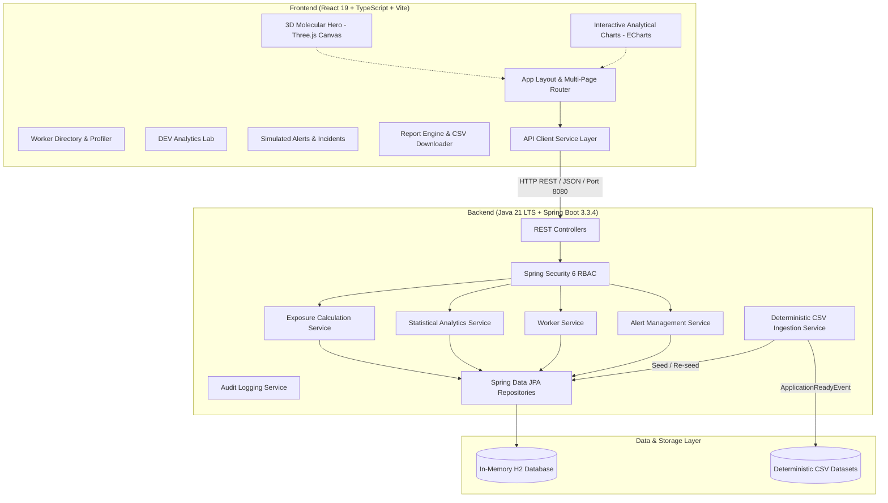
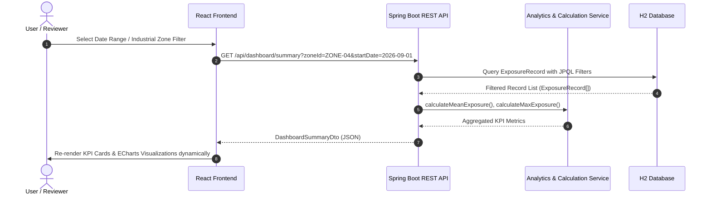

# ChromaGuard — Architecture & System Workflow Documentation

## 1. System Overview

**ChromaGuard** is an industrial safety intelligence and academic demonstration platform designed to illustrate full-stack software engineering, Java 21 enterprise backend services, and academic Data Exploration & Visualization (DEV) principles.

---

## 2. Component Architecture

### 2.1 Backend Layers (Java 21 & Spring Boot)

1. **Entity Layer (`com.chromaguard.entity`)**:
   - `Worker`: Models synthetic personnel identity, assigned zone, shift, badge ID, and tenure.
   - `IndustrialZone`: Defines facility operational units with baseline target exposures and risk tiers.
   - `Shift`: Defines 8-hour shift windows (Morning, Afternoon, Night).
   - `ExposureRecord`: Stores timestamped event dosimeter readings, synthetic RGB color channels, and status.
   - `Alert`: Tracks Warning and Critical threshold exceedances with acknowledgement audit state.
   - `UserAccount`: Stores role-based credentials (`ROLE_ADMIN`, `ROLE_WORKER`, `ROLE_AUDITOR`).
   - `DemoAuditLog`: Audit trail tracking administrative reset actions and alert acknowledgements.

2. **Repository Layer (`com.chromaguard.repository`)**:
   - Extends Spring Data `JpaRepository`.
   - Provides optimized JPQL queries supporting dynamic multi-criteria filtering across date ranges, zones, shifts, and workers.

3. **Service Layer (`com.chromaguard.service` & `com.chromaguard.analytics`)**:
   - `ExposureCalculationService`: Pure Java implementation of cumulative dose integration $D = \sum (C_i \cdot \Delta t \cdot \eta)$ and threshold evaluations.
   - `AnalyticsService`: Implements parametric statistics (mean, std dev, variance) and non-parametric metrics (median, Q1, Q3, IQR), Tukey outlier fences ($Q_1 - 1.5 \cdot IQR$, $Q_3 + 1.5 \cdot IQR$), and Pearson correlation matrices using the Java Streams API.
   - `DataIngestionService`: Reads deterministic CSV datasets on startup and reloads upon reset.
   - `AlertService`: Provides atomic alert state transitions and logs operator notes.

4. **Controller Layer (`com.chromaguard.controller`)**:
   - Exposes RESTful JSON endpoints with CORS support, query parameter binding, and global error handling via `@ControllerAdvice`.

---

### 2.2 Frontend Architecture (React 19 + TypeScript + Vite)

1. **Presentation & Navigation**:
   - Persistent desktop left sidebar with route transitions.
   - Compact responsive navigation for mobile and tablet screens.
   - Global persistent header showing page title, current user role, and active **DEMO DATA / SIMULATED** indicator.

2. **3D Molecular Hero Visualization**:
   - Hardware-accelerated Three.js canvas rendering a scientifically accurate $H_2S$ molecular model (92.1° bond angle, translucent sulfur core, electron cloud particles, pointer parallax interaction).
   - Graceful vector 2D fallback for devices without WebGL.

3. **Interactive Analytical Visualizations**:
   - Powered by Apache ECharts with dark-mode theming:
     - Multi-series exposure timeline (Line chart).
     - Observed exposure vs target baseline by zone (Bar chart).
     - Categorical simulation status distribution (Donut chart).
     - 10-bin exposure frequency histogram (Histogram).
     - Top exposed personnel ranking (Horizontal bar chart).
     - Multi-day zone-by-time exposure intensity matrix (Heatmap).

---

## 3. Data Processing & Demonstration Pipeline

---

## 4. Security & Access Control

- **Spring Security 6** architecture with stateless endpoints.
- Public read access (`GET /api/**`) for seamless academic evaluation and interactive demonstration.
- Protected administrative endpoints (`POST /api/demo/reset`, `POST /api/alerts/{id}/acknowledge`) requiring operator attribution and logging changes into `demo_audit_logs`.
- Development seeded accounts:
  - `admin` / `admin123` (`ROLE_ADMIN`)
  - `auditor` / `audit123` (`ROLE_AUDITOR`)
  - `worker` / `worker123` (`ROLE_WORKER`)
